# Awesome FinOps & Cloud Cost Management

  

  
  
  
  
  
  

---

## 📌 Overview

> **Awesome FinOps & Cloud Cost Management** is an authoritative, actively maintained, curated directory of the best **FinOps platforms**, **cloud cost optimization tools**, **Kubernetes cost allocation engines**, and **infrastructure-as-code (IaC) cost estimators**. Whether you are building financial governance across AWS, Microsoft Azure, Google Cloud Platform (GCP), or multi-cloud container architectures, this guide covers both enterprise SaaS market leaders and self-hosted open-source software (OSS).

🌟 **Star this repository** to stay updated on emerging FinOps and cloud cost management tooling!

---

## 📋 Table of Contents

- [Sector Overview & Market Dynamics](#-sector-overview--market-dynamics)
- [SaaS / Hosted Platforms](#-saas--hosted-platforms)
  - [Commercial FinOps Matrix](#commercial-finops-matrix)
  - [SaaS Product Deep Dives](#saas-product-deep-dives)
- [Open-Source Software](#-open-source-software)
  - [Open-Source FinOps Leaderboard](#open-source-finops-leaderboard)
  - [Open-Source Project Details](#open-source-project-details)
- [Key FinOps Evaluation Criteria](#-key-finops-evaluation-criteria)
- [Contributing](#-contributing)
- [License](#-license)

---

## 🌐 Sector Overview & Market Dynamics

The global **Cloud Cost Management and FinOps** market was valued between **$13.4B and $14.8B in 2024–2025** and is projected to surpass **$26B to $33B by 2030**, expanding at a robust compound annual growth rate (**CAGR**) of **12% to 18%**. 

Structurally, the market exhibits a **hybrid dynamic**: it is **moderately concentrated at the top tier**—dominated by cloud hyperscalers (AWS, Azure, GCP native billing tools) and multi-billion-dollar enterprise consolidators (IBM/Apptio, Datadog, NetApp/Flexera)—yet **highly fragmented across functional specializations**. Rapidly expanding vectors like Kubernetes pod-level allocation, automated rate arbitrage (RI/SP commitment automation), and decentralized GenAI LLM token attribution continue to drive a thriving ecosystem of agile venture-backed startups and open-source innovations that prevent total monopolization.

---

## 🟦 SaaS / Hosted Platforms

Commercial, cloud-hosted FinOps and cost management platforms. These platforms provide turn-key dashboards, automated commitment execution, multi-cloud data aggregation, and anomaly alerts.

### Commercial FinOps Matrix

*Sorted descending by company scale (market capitalization / enterprise valuation).*

| Product / Company | Company Scale (Valuation / Market Cap) | Starting Specific Pricing Tier | Free Tier Limits / Free Trial Plan | Best For |
| :--- | :--- | :--- | :--- | :--- |
| [**Snowflake Cost Management**](https://www.snowflake.com/) | ~$112B Market Cap (Public: `SNOW`) | Standard Edition starts at **$2.00 per capacity credit** | **30-day free trial** with **$400 in free usage credits** | Native Snowflake data warehouse & compute cost governance |
| [**Datadog Cloud Cost Management**](https://www.datadoghq.com/pricing/) | ~$92B Market Cap (Public: `DDOG`) | **$5.00 per $1,000 of cloud spend/month** (CCM Pro, annual) | **14-day free trial** with full multi-cloud ingestion; Free $0 tier for native Datadog cost visibility | Infrastructure observability with operational cost context |
| [**Spot by NetApp**](https://spot.io/) | ~$42B Parent Market Cap (Public: `NTAP`) | **$0.19 per managed vCPU/month** (Ocean) or outcome-based share | **14-day free trial** with sandbox evaluation & guided cloud spend assessment | Automated spot instance management & compute workload autoscaling |
| [**Harness Cloud Cost Management**](https://www.harness.io/pricing) | ~$5.5B Valuation (Series E) | Paid plans start at **$500/month** (modular CACM add-on) | **Free Forever Tier**: Up to **$250,000/year cloud spend**, 2 Kubernetes clusters, 10 AutoStopping rules, 30 days data retention | DevOps & CI/CD teams integrating automated resource stopping |
| [**Apptio Cloudability**](https://www.apptio.com/products/cloudability/) | $4.6B Acquisition by IBM | Base Tier 1 starts at **$2,500/month** ($30,000/yr for up to $1M cloud spend) | **30-day proof-of-concept (POC)** enterprise evaluation upon sales consultation | Large-scale enterprise multi-cloud governance & FinOps chargeback |
| [**CloudZero**](https://www.cloudzero.com/) | ~$224M Valuation (Series C, $119M raised) | **$19 per $1,000 of monthly AWS spend** (~0.6%–1% effective spend rate) | **14-day structured POC pilot** evaluating live cloud bill & unit metrics | Unit economics (cost per customer, tenant, product feature) |
| [**Vantage**](https://www.vantage.sh/pricing) | ~$150M Valuation ($25M+ venture raised) | **$30/month** (Pro Tier; Business Tier at $200/month) | **Free Forever Tier**: Up to **$2,500/month cloud spend**, 30+ multi-cloud integrations, unlimited users | Startups & mid-market engineering teams needing multi-cloud visibility |
| [**Anodot**](https://www.anodot.com/) | ~$70M Total Funding Raised (Series C) | Enterprise entry tier starts at **$1,000/month** | **30-day guided pilot / POC** with cloud waste audit and anomaly simulation | AI/ML-driven anomaly detection correlated with revenue metrics |
| [**ProsperOps**](https://www.prosperops.com/) | Flexera Acquisition ($72M Growth Funding) | **Outcome-based: 30% to 35% of net incremental savings** ($0 starting fee) | **Free Cloud Savings Analysis** (read-only historical audit) with no upfront payment | Automated hands-off AWS & Azure Savings Plans / RI discount management |
| [**Kubecost (Commercial)**](https://www.kubecost.com/pricing) | Acquired by IBM (Apptio Division) | **$8/node/month** (Enterprise self-hosted) or **$449/month** (Business tier) | **Free Forever Tier**: Up to **250 CPU cores** (single cluster), 15-day metrics retention limit | Managed Kubernetes cost allocation with enterprise governance |

---

### SaaS Product Deep Dives

#### Snowflake Cost Management & Resource Monitors
Snowflake provides built-in Resource Monitors that track credit usage across virtual warehouses with custom suspend and notification triggers. Built-in cost governance encompasses account-level compute spend, storage volume, and query optimization views (`ACCOUNT_USAGE`).
- **Target Audience:** Data engineers and financial analysts focused on Snowflake data lakehouse optimization.

#### Datadog Cloud Cost Management
Correlates infrastructure billing metrics directly with application performance telemetry, traces, and host telemetry. Enables root-cause analysis by viewing how code deployments and traffic spikes impact infrastructure invoices.
- **Target Audience:** Engineering teams running mission-critical microservices who require unified observability and FinOps.

#### Spot by NetApp
Delivers automated workload scaling, container bin-packing (Ocean), and compute arbitrage (Elastigroup). Proactively predicts spot instance interruptions and gracefully shifts workloads to optimal compute pools without human intervention.
- **Target Audience:** High-scale compute, batch rendering, and data science workloads demanding deep compute discounts.

#### Harness Cloud Cost Management (CACM)
Part of the Harness Software Delivery platform. CACM couples continuous deployment with automated cost controls, including ML-driven AutoStopping rules that safely terminate idle non-production environments and spin them back up on request.
- **Target Audience:** DevOps and platform teams automating ephemeral dev/test environments.

#### Apptio Cloudability
The veteran enterprise multi-cloud cost visibility and unit economics suite. Features comprehensive budgeting, hierarchical chargeback/showback structures, and automated commitment planning across AWS, GCP, and Azure.
- **Target Audience:** Fortune 500 enterprises needing institutional FinOps compliance and corporate accounting integration.

#### CloudZero
CloudZero ingests raw billing records alongside custom business dimensions (via telemetry and API) to calculate unit costs—such as cost per user, cost per API call, and cost per product tier.
- **Target Audience:** SaaS founders, product owners, and engineering leaders who report margins to executive boards.

#### Vantage
A developer-centric cloud cost visibility platform featuring pre-built dashboards, provider integrations (Datadog, Snowflake, AWS, GCP, Azure, MongoDB, OpenAI), and financial forecasting with transparent public tier pricing.
- **Target Audience:** Startups and modern engineering teams seeking rapid onboarding without multi-week sales calls.

#### Anodot
Combines multi-cloud FinOps visibility with proprietary machine learning anomaly detection to uncover cloud waste, rogue instances, and runaway database queries in real time.
- **Target Audience:** Teams managing complex, high-velocity infrastructure looking for automated spend alerts.

#### ProsperOps
Operates as an autonomous discount optimizer for compute spend. Continuously buys, sells, and optimizes AWS Savings Plans and Reserved Instances (RIs) to maximize the Effective Savings Rate (ESR) without engineering risk.
- **Target Audience:** Cloud organizations spending $20k+/month on compute looking to maximize discount coverage.

#### Kubecost
The enterprise product built upon OpenCost. Delivers multi-cluster cost allocation, idle resource identification, network egress cost tracking, and integration with Prometheus and Grafana.
- **Target Audience:** Platform engineers managing enterprise-scale multi-tenant Kubernetes fleets.

---

## 🟩 Open-Source Software

Self-hosted, transparent, and community-driven FinOps solutions. Deploy these tools directly in your private VPC, Kubernetes clusters, or CI/CD pipelines without sharing proprietary billing data externally.

### Open-Source FinOps Leaderboard

*Sorted descending by GitHub star count.*

| Repository | GitHub Stars | Stack | Primary Focus | Best For |
| :--- | :---: | :--- | :--- | :--- |
| [**infracost/infracost**](https://github.com/infracost/infracost) |  | Go / CLI / Terraform | Shift-Left IaC Cost Prevention | Terraform PR cost diffs & budget guardrails |
| [**opencost/opencost**](https://github.com/opencost/opencost) |  | Go / Prometheus / K8s | CNCF Kubernetes Cost Allocation | Real-time container pod-level cost attribution |
| [**cloudquery/cloudquery**](https://github.com/cloudquery/cloudquery) |  | Go / SQL / Data Pipeline | Multi-Cloud Asset & Spend Inventory | Querying cloud assets and billing via SQL/PostgreSQL |
| [**cloud-custodian/cloud-custodian**](https://github.com/cloud-custodian/cloud-custodian) |  | Python / YAML DSL | Cost Governance & Auto-Remediation | Rules-based enforcement, off-hours shutdown & tag hygiene |
| [**robusta-dev/krr**](https://github.com/robusta-dev/krr) |  | Python / Prometheus | K8s Resource Rightsizing (CPU/RAM) | Generating workload request/limit recommendations |
| [**tailwarden/komiser**](https://github.com/tailwarden/komiser) |  | Go / React / TypeScript | Multi-Cloud Resource Inspector | Lightweight multi-cloud inventory & cost dashboard |
| [**Teevity/ice**](https://github.com/Teevity/ice) |  | Java / Grails | AWS Detailed Billing Usage Analysis | Deep historical analysis of AWS usage records |
| [**openmeterio/openmeter**](https://github.com/openmeterio/openmeter) |  | Go / ClickHouse / Kafka | Real-time Metering & AI Token Billing | Metering GenAI token usage and developer API usage |
| [**hystax/optscale**](https://github.com/hystax/optscale) |  | Python / Angular / Docker | Full-Stack Multi-Cloud FinOps | Multi-cloud cost tracking & AI/ML GPU cost governance |
| [**gocrane/crane**](https://github.com/gocrane/crane) |  | Go / Kubernetes CRDs | Cloud Resource Analytics & Economics | Autoscaling, QoS management, and pod rightsizing |

---

### Open-Source Project Details

#### 1. [Infracost](https://github.com/infracost/infracost)
- **Stack:** Go / CLI | **License:** Apache 2.0
- **Overview:** Infracost sits directly in developer CI/CD workflows (GitHub Actions, GitLab CI, Atlantis) and calculates cost impacts of pull requests before Terraform code is merged or provisioned. Shows line-by-line financial diffs on PR reviews.
- **Why it stands out:** Prevents cloud bill surprises at the pull request stage rather than 30 days later when the invoice arrives.

#### 2. [OpenCost](https://github.com/opencost/opencost)
- **Stack:** Go / Prometheus | **License:** Apache 2.0
- **Overview:** A CNCF Incubating project defining open vendor-neutral specifications for Kubernetes cost allocation. Accurately attributes compute, memory, storage, and network costs down to the namespace, deployment, and pod level.
- **Why it stands out:** Backed by CNCF and industry heavyweights; integrates natively with existing Prometheus deployments.

#### 3. [CloudQuery](https://github.com/cloudquery/cloudquery)
- **Stack:** Go / SQL | **License:** Open Source
- **Overview:** High-performance data integration engine that extracts configuration, asset inventory, and billing data from 70+ cloud providers (AWS, Azure, GCP) and syncs them into PostgreSQL, ClickHouse, or Snowflake.
- **Why it stands out:** Allows FinOps practitioners to query their entire multi-cloud inventory and cost profiles using standard SQL.

#### 4. [Cloud Custodian](https://github.com/cloud-custodian/cloud-custodian)
- **Stack:** Python / YAML | **License:** Apache 2.0
- **Overview:** A CNCF project providing a lightweight rules engine for cloud security, governance, and cost management. Uses simple YAML policies to filter resources, enforce off-hours shutdown schedules, and delete orphaned EBS volumes.
- **Why it stands out:** Native event-driven serverless auto-remediation that acts directly on cloud infrastructure.

#### 5. [Robusta KRR (Kubernetes Resource Recommender)](https://github.com/robusta-dev/krr)
- **Stack:** Python | **License:** MIT
- **Overview:** Connects to cluster Prometheus instances to evaluate actual pod CPU and memory utilization against configured requests and limits, outputting actionable rightsizing recommendations.
- **Why it stands out:** Fast CLI tool that runs in seconds without requiring extra in-cluster agent daemons.

#### 6. [Komiser](https://github.com/tailwarden/komiser)
- **Stack:** Go / React | **License:** MIT / Open Source
- **Overview:** A cloud-agnostic resource manager that analyzes spend, resource distribution, and compliance across AWS, Azure, GCP, DigitalOcean, Scaleway, and Kubernetes from a unified dashboard.
- **Why it stands out:** Single binary execution with zero complex dependencies.

#### 7. [Teevity Ice](https://github.com/Teevity/ice)
- **Stack:** Java | **License:** Apache 2.0
- **Overview:** Originally developed by Netflix, Ice delivers detailed breakdown graphs of AWS Cost and Usage Reports (CUR), showing hourly trends across accounts, regions, and services.
- **Why it stands out:** Proven open-source architecture for processing high-volume AWS detailed billing records.

#### 8. [OpenMeter](https://github.com/openmeterio/openmeter)
- **Stack:** Go / ClickHouse | **License:** Apache 2.0
- **Overview:** An open-source usage metering platform built for modern AI, API, and developer-first applications. Aggregates millions of events per second to enable unit cost monitoring and consumption billing.
- **Why it stands out:** Ideal for calculating per-token GenAI spend and passing real-time infrastructure costs to consumers.

#### 9. [OptScale](https://github.com/hystax/optscale)
- **Stack:** Python / Docker | **License:** Apache 2.0
- **Overview:** A full-stack self-hosted FinOps platform supporting AWS, Azure, GCP, Alibaba Cloud, and Kubernetes. Highlights GPU workload optimization, ML training cost analysis, and custom budget alerts.
- **Why it stands out:** One of the few open-source platforms with dedicated features for tracking AI/ML training spend.

#### 10. [Crane](https://github.com/gocrane/crane)
- **Stack:** Go / Kubernetes | **License:** Apache 2.0
- **Overview:** Developed to maximize cloud resource economics in Kubernetes clusters, Crane provides dynamic rightsizing, predictive autoscaling (using time-series forecasting), and QoS scheduling.
- **Why it stands out:** Couples cost visibility with active automated cluster resource scheduling.

---

## 🎯 Key FinOps Evaluation Criteria

When selecting between commercial SaaS and self-hosted open-source tooling, consider:

1. **Deployment Architecture & Privacy:** Does your security posture allow exporting cloud billing telemetry to external SaaS vendors, or must data remain in your private VPC (e.g., OpenCost, Cloud Custodian)?
2. **Pricing Model Alignment:** Do you prefer fixed monthly subscriptions (Vantage), spend-percentage models (Datadog, CloudZero), or performance-contingent savings shares (ProsperOps)?
3. **Shift-Left Prevention vs. Post-Mortem Analytics:** Are you trying to block expensive infrastructure during code review (Infracost) or reconcile historical billing invoices across teams (Cloudability)?
4. **Granular Unit Economics:** Can the tool translate aggregate cloud spend into per-customer, per-transaction, or per-feature metrics (CloudZero, OpenMeter)?
5. **Automation vs. Recommendations:** Do you want recommendations that your DevOps team executes manually, or continuous closed-loop autopilot execution (Spot, ProsperOps, Crane)?

---

## 🤝 Contributing

Contributions, additions, and corrections are welcome! If you know of an active, well-maintained FinOps or cloud cost optimization tool:

1. Fork this repository.
2. Add your project to the appropriate table and category with verified data.
3. Submit a Pull Request with a clear description and links.

Please review our [Contributing Guidelines](https://github.com/ishandutta2007/Awesome-Finops-Cloud-Cost-Management/blob/main/README.md) before submitting.

---

## 📄 License

This repository is licensed under the [MIT License](https://github.com/ishandutta2007/Awesome-Finops-Cloud-Cost-Management/blob/main/LICENSE).

---

  Maintained with ❤️ by <a href="https://github.com/ishandutta2007">Ishan Dutta</a> and the open-source FinOps community.

